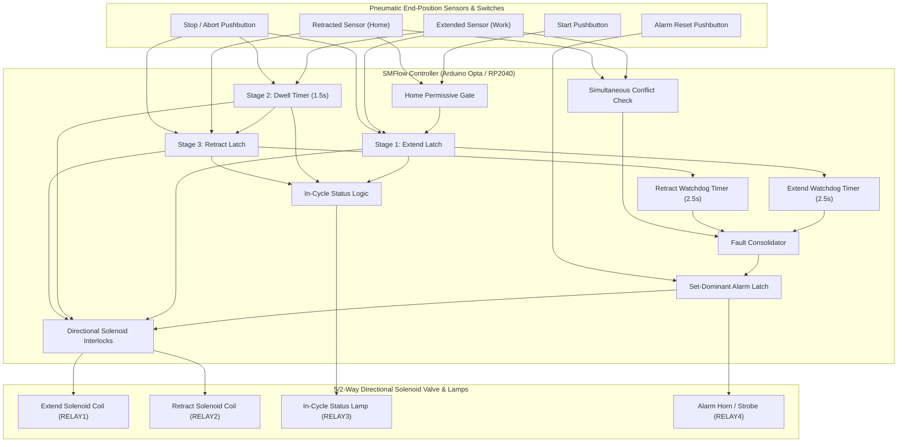
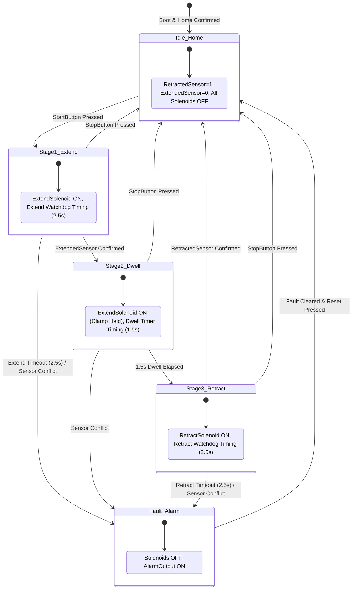

# Pneumatic Cylinder Sequencer — Technical Architecture

This document specifies the technical architecture, pneumatic dynamics, electrical interfaces, timing diagrams, safety state machines, and DAG execution topology for an SMFlow-based **Pneumatic Cylinder Sequencer** running on industrial micro-PLCs (**Arduino Opta**) and embedded targets (**Raspberry Pi Pico**).

---

## 1. Executive Summary & Pneumatic Dynamics

Pneumatic cylinders convert compressed air into linear mechanical motion. Unlike hydraulic systems, compressed air is highly compressible, behaving as a non-linear spring with significant pneumatic capacitance and transmission delay.



### 1.1 Air Compressibility & Stick-Slip Dynamics
Pneumatic actuators exhibit non-linear friction characteristics (Stribeck friction curve). Static seal friction (breakaway force) is significantly higher than dynamic sliding friction:

$$F_{\text{breakaway}} > F_{\text{coulomb}} + F_{\text{viscous}} \cdot v$$

When a directional solenoid shifts, air enters the cylinder bore, but the piston does not move until pressure builds sufficiently to overcome static friction:

$$P_{\text{bore}} \cdot A_{\text{piston}} \ge F_{\text{load}} + F_{\text{breakaway}}$$

Once breakaway occurs, the cylinder accelerates rapidly until backpressure builds in the exhausting chamber (regulated by meter-out flow controls). If air supply pressure drops or a mechanical guide binds, the cylinder stalls mid-stroke. The controller incorporates **Dual Watchdog Jam Timers (`2.5s`)** to catch stalls before solenoid coils overheat or adjacent mechanisms crash.

### 1.2 End-of-Stroke Cushioning & Clamping Force
In fixtures and small presses, the cylinder must dwell at full stroke under pressure to:
1. Allow fluidic pressure to equalize across the entire piston area:

   $$F_{\text{clamp}} = P_{\text{line}} \cdot \frac{\pi}{4} D_{\text{bore}}^2$$

2. Provide mechanical stabilization while an assembly operation (crimping, drilling, or ejection) takes place.
The controller enforces a calibrated **1.5-second Dwell Phase** where `ExtendSolenoid` remains energized before retracting.

---

## 2. Electrical System & Field Interface

```
[ OPERATOR CONTROLS & REED SWITCHES ]                 [ ARDUINO OPTA MICRO-PLC ]

  +24VDC Industrial Bus ───────┬─────────────────────── +24V Supply
                               │
  Start Pushbutton (NO) ───────┼─────────────────────── Terminal I1 (DI)
  Stop Pushbutton (NC/NO) ─────┼─────────────────────── Terminal I2 (DI)
  Reset Pushbutton (NO) ───────┼─────────────────────── Terminal I3 (DI)
                               │
  Retracted Reed Switch (Home) ┼──[ Magnetic Reed ]──── Terminal I4 (DI)
  Extended Reed Switch (Work) ─┴──[ Magnetic Reed ]──── Terminal I5 (DI)

[ PNEUMATIC VALVE SOLENOIDS & ANNUNCIATORS ]

  +24VDC Valve Power ──────────┬─────────────────────── RELAY 1 Common
                               │
  5/2 Valve Extend Coil ◄──────┴─────────────────────── RELAY 1 NO (10A Contact)
                               │  [ Flyback Diode / TVS ]
                               ┴

  5/2 Valve Retract Coil ◄─────┬─────────────────────── RELAY 2 NO
                               │
  In-Cycle Indicator Lamp ◄────┼─────────────────────── RELAY 3 NO
  Alarm Strobe / Horn ◄────────┴─────────────────────── RELAY 4 NO
```

### 2.1 Magnetic Reed vs. Solid-State Sensor Interfacing
Pneumatic cylinders commonly mount either:
- **Magnetic Reed Switches**: Hermetically sealed contacts closed by the piston's permanent magnetic ring. Reed switches are susceptible to contact welding under inrush capacitive loads and bounce transients.
- **Solid-State PNP/NPN Magneto-Resistive / Hall Effect Sensors**: No moving parts, faster switching speed, but sensitive to wiring shorts.

**Failure Mode Mitigation**: If a sensor cable is pinched or a reed switch welds shut, both `RetractedSensor` and `ExtendedSensor` can read active simultaneously. The controller's **Sensor Plausibility Checker (`cmp_sensor_conflict`)** immediately trips and locks out all pneumatic motion.

### 2.2 Solenoid Inductive Arc Suppression
Solenoid valve coils generate significant inductive kickback ($V = -L \frac{di}{dt}$). Flyback diodes (1N4007 for DC coils) or bidirectional TVS diodes (transient voltage suppressors) across the coils prevent relay contact welding and protect the micro-PLC from ground-bounce reset transients.

---

## 3. Sequence State Machine & Timing Diagrams



### 3.1 Normal Cycle Sequence Timing

```mermaid
sequenceDiagram
    autonumber
    actor Operator
    participant Controller as SMFlow Sequencer
    participant Cylinder as Pneumatic Actuator
    participant Sensors as Position Sensors

    Note over Cylinder,Sensors: Cylinder at Home (RetractedSensor=1)
    Operator->>Controller: Press StartButton
    Controller->>Cylinder: ExtendSolenoid ON (Stage 1)
    Controller->>Controller: Start Extend Watchdog (2.5s)
    Cylinder->>Sensors: Leaves Home (RetractedSensor -> 0)
    Cylinder->>Sensors: Hits Work Position (ExtendedSensor -> 1)
    Sensors->>Controller: ExtendedSensor confirmed
    Controller->>Controller: Stop Watchdog; Start Dwell Timer (1.5s)
    Note over Controller,Cylinder: Stage 2 Dwell: ExtendSolenoid stays ON (Clamping)
    Controller->>Controller: 1.5s Dwell expires
    Controller->>Cylinder: ExtendSolenoid OFF, RetractSolenoid ON (Stage 3)
    Controller->>Controller: Start Retract Watchdog (2.5s)
    Cylinder->>Sensors: Leaves Work (ExtendedSensor -> 0)
    Cylinder->>Sensors: Hits Home Position (RetractedSensor -> 1)
    Sensors->>Controller: RetractedSensor confirmed
    Controller->>Cylinder: RetractSolenoid OFF (Stage Complete)
    Controller->>Controller: InCycleOutput extinguished -> Ready
```

---

## 4. Directed Acyclic Graph (DAG) Execution Topology

In SMFlow, compilation produces native C++ without runtime interpreters. Cyclic connections are strictly prohibited by the compiler. All sequential transitions flow forward in a topological pipeline:

```
[Hardware Inputs] ──► [Conflict & Home Check] ──► [Stage Latches & Timers] ──► [Interlocks & Output Gates] ──► [Relay Drivers]
```

1. **Cycle Independence**: Each stage latch (`latch_extend`, `latch_retract`) is reset directly by physical inputs (`ExtendedSensor`, `RetractedSensor`, `StopButton`, `ResetButton`), ensuring zero feedback edges.
2. **Watchdog Monitoring**: Watchdog on-delay timers (`ton`) monitor motion latches in feedforward fashion. Their outputs feed forward into the safety alarm latch (`latch_alarm`), which gates the final actuator outputs (`gate_extend_final`, `gate_retract_final`).
3. **Execution Determinism**: The complete graph evaluates in a deterministic 10ms scan period with zero heap allocation and bounded execution time.

---

## 5. Hardware Target Profiles

### 5.1 Arduino Opta Micro-PLC
- **Architecture**: STMicroelectronics STM32H747XI ARM Cortex-M7 (480 MHz).
- **Physical Relays**: 4× SPST relays rated for 10A at 250VAC / 30VDC.
- **Physical Inputs**: 8× 12–24V digital inputs (I1–I8).
- **Hardware Watchdog**: Integrated hardware watchdog configured for safety shutdown.

### 5.2 Raspberry Pi Pico (`rp2040-pico`)
- **Architecture**: Dual ARM Cortex-M0+ at 133 MHz.
- **Pin Mapping**: GP14–GP18 digital inputs; GP20–GP22 and GP27 pilot external 24V relay modules.

### 5.3 SMFlow Simulator (`simulator`)
- **Virtual IO**: Full automated CI test coverage via `.smtest` specifications with millisecond-exact virtual clock advancement.
