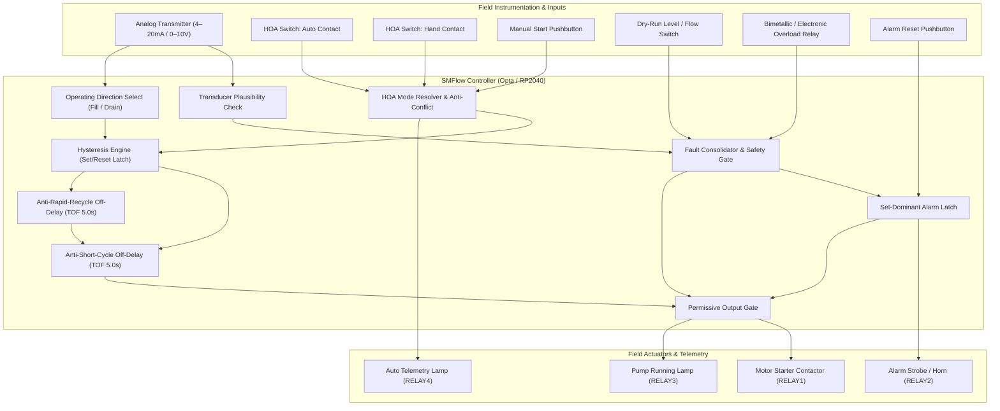
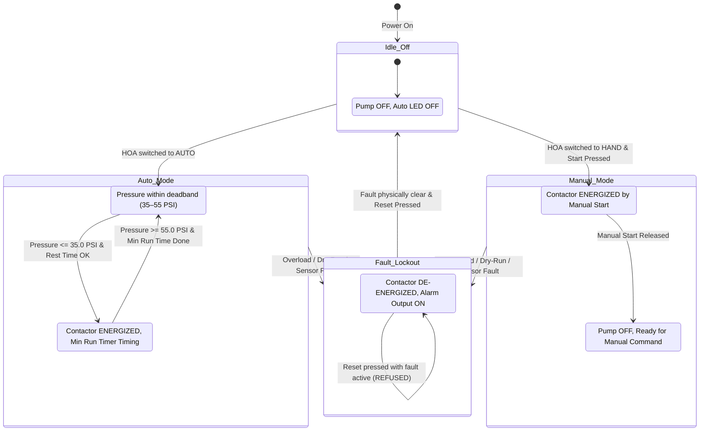
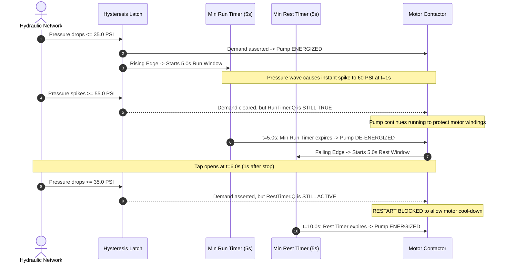

# Industrial Pump Controller — Technical Architecture

This document specifies the technical architecture, electrical interfaces, fluid thermodynamics, control algorithms, functional safety requirements, and fail-safe state machines for an SMFlow-based **Industrial Pump Controller** deployed on deterministic micro-PLCs (**Arduino Opta**) and embedded targets (**Raspberry Pi Pico**).

---

## 1. Executive Summary & Physical Dynamics

Industrial and agricultural pumping installations are high-inertia electromechanical systems. Operating a pump involves managing fluid momentum, acoustic pressure waves (water hammer), motor rotor heating, and cavitation. Unbuffered or naive electronic control leads directly to physical hardware destruction.



### 1.1 Fluid Dynamics & Water Hammer Mitigation
When a high-flow pump shuts down abruptly, momentum in the moving liquid column generates a low-pressure rarefaction wave followed by an extreme high-pressure reflected wave upon hitting closed check valves.
According to the **Joukowsky equation**:

$$\Delta P = \rho \cdot c \cdot \Delta v$$

Where:
- $\rho$ is fluid density ($1,000 \text{ kg/m}^3$ for water),
- $c$ is the acoustic wave speed in the pipe ($1,000 \text{ to } 1,400 \text{ m/s}$ depending on pipe elasticity),
- $\Delta v$ is the instantaneous change in fluid velocity.

A sudden change of only $2.0 \text{ m/s}$ in a rigid steel water line induces a pressure surge exceeding:

$$\Delta P = 1000 \cdot 1200 \cdot 2.0 = 2.4 \text{ MPa } (\approx 350 \text{ PSI / } 24 \text{ bar})$$

This surge ruptures pipe joints, destroys pressure transducers, and causes check valve disc slamming. The SMFlow controller addresses this by enforcing **Minimum Run Time (5.0s)** and **Hysteresis Deadband (20.0 PSI)** to ensure the pump does not oscillate around pressure thresholds during rapid hydraulic transients.

### 1.2 Submersible Motor Cooling & Anti-Rapid-Recycle Thermodynamics
Submersible 2-pole and 4-pole pump motors rely on fluid velocity across the stainless steel motor shell to dissipate stator heat. During starting, the locked-rotor current (typically $6\times \text{FLC}$) causes $I^2 R$ heat generation inside copper rotor bars and stator slots at a rate of up to $15^\circ\text{C/second}$.

If a pump is stopped and immediately restarted, residual heat combines with the new starting surge, exceeding the thermal endurance of NEMA Class F / Class H winding insulation ($155^\circ\text{C} / 180^\circ\text{C}$). The **Minimum Rest Delay (5.0s / 5000ms)** guarantees that contactors cannot re-strike before the motor rotor sheds surface heat and line voltage recovers.

### 1.3 Net Positive Suction Head (NPSH) & Dry-Run Destruction
Centrifugal pump impellers spinning without liquid incur severe damage:
1. **Cavitation**: If suction pressure falls below vapor pressure, vapor bubbles implode against impeller vanes at up to $100,000 \text{ PSI}$, eroding metallic surfaces.
2. **Seal Melting**: Mechanical face seals (silicon carbide or tungsten carbide vs carbon) rely on a micron-thin liquid film for lubrication. Dry running boils this boundary film within 30 seconds, shattering brittle face rings.
3. **Internal Bushing Seizure**: Water-lubricated ceramic or bronze guide bushings score and weld to the shaft.

The controller implements a dedicated hardwired **Dry-Run Fault Input** coupled with **Sensor Plausibility Monitoring** that cuts off the motor contactor instantly, bypassing all run timers.

---

## 2. Electrical System & Interface Specification

```
[ FIELD WIRING & SENSORS ]                            [ ARDUINO OPTA PRO CONTROLLER ]

  24VDC Loop Power (+) ─────┬────────────────────────── +24VDC Supply
                            │
  4–20mA Pressure/Level Tx ─┴──[ 250Ω 0.1% ]──┬──────── Terminal I1 (0–10V / 0–5V AI)
                                              │
  24VDC Ground (-) ───────────────────────────┴──────── 0VDC / Earth

  HOA Switch AUTO Contact ────[ +24V Switched ]──────── Terminal I2 (DI)
  HOA Switch HAND Contact ────[ +24V Switched ]──────── Terminal I3 (DI)
  Manual Start Pushbutton ────[ +24V Switched ]──────── Terminal I4 (DI)
  Dry-Run Suction Float   ────[ +24V Switched ]──────── Terminal I5 (DI)
  Thermal Overload 95/96  ────[ +24V Switched ]──────── Terminal I6 (DI)
  Alarm Reset Pushbutton  ────[ +24V Switched ]──────── Terminal I7 (DI)

[ HIGH VOLTAGE CONTACTORS & ACTUATORS ]

  120VAC / 24VDC Hot ───────┬────────────────────────── RELAY 1 Common
                            │
  Motor Starter Coil ◄──────┴────────────────────────── RELAY 1 NO (10A Contact)
                            │  [ RC Snubber 0.1µF+100Ω ]
                            ┴

  Alarm Horn / Strobe ◄──────────────────────────────── RELAY 2 NO
  Run Status Lamp (Green) ◄──────────────────────────── RELAY 3 NO
  Auto Telemetry (Amber) ◄───────────────────────────── RELAY 4 NO
```

### 2.1 Sensor Conditioning & Scaling
- The analog input on Terminal `I1` supports standard 0–10V industrial signals. When using standard 2-wire 4–20mA loop-powered transmitters, a precision $250\,\Omega \pm 0.1\%$ metal-film resistor across input terminals converts $4\text{–}20\text{ mA}$ to $1.0\text{–}5.0\text{ V}$.
- **Plausibility Detection**:
  - $PV < 0.0$: Sensed loop current $< 4\text{ mA}$ (typically $< 3.6\text{ mA}$ indicating broken field wiring or disconnected transmitter).
  - $PV > 100.0$: Over-range or shorted transmitter power rail.
  - In either condition, `gate_sensor_fault` trips and locks out automatic pump operation.

### 2.2 Relay Snubber Suppression
Motor contactor coils present significant inductive reactance ($L$). Breaking contactor current induces a high-voltage back-EMF arc:

$$V = -L \frac{di}{dt}$$

Standard industrial practice requires an RC snubber network ($0.1\,\mu\text{F} + 100\,\Omega$ rated for $250\text{VAC}$) or metal oxide varistor (MOV) placed across RELAY1 contacts to suppress arcing and prevent high-frequency EMI from resetting the micro-PLC microcontroller.

---

## 3. Control Algorithms & Logic Design



### 3.1 Closed-Loop Hysteresis Engine
To prevent oscillatory hunting around a single threshold setpoint, the controller implements an asymmetric hysteresis window:

$$\text{Cut-In (Start)} = 35.0 \text{ PSI}$$
$$\text{Cut-Out (Stop)} = 55.0 \text{ PSI}$$
$$\text{Deadband} = 55.0 - 35.0 = 20.0 \text{ PSI}$$

The state is preserved deterministically inside `latch_process_demand` (IEC 61131-3 Set/Reset latch):
- **Set Condition**: `(ProcessVariable <= StartThreshold) AND NOT SensorFault`
- **Reset Condition**: `(ProcessVariable >= StopThreshold) OR SensorFault`

In **Pump-Down Mode (`PumpDownMode == true`)** (sump / pit drainage):
- `sel_start_cond` multiplexes the start trigger to `(ProcessVariable >= StartThreshold)` (high level).
- `sel_stop_cond` multiplexes the stop trigger to `(ProcessVariable <= StopThreshold)` (low level).

### 3.2 Anti-Short-Cycling & Anti-Rapid-Recycle Sequence



### 3.3 Set-Dominant Alarm Interlock
Safety requires that operator action cannot bypass active hardware faults:
- `latch_alarm` is an IEC 61131-3 Set-Reset block where:
  - Input `S` is driven by `gate_any_fault` (`DryRunFault OR OverloadFault OR SensorFault`).
  - Input `R` is driven by `AlarmReset`.
- **Set Dominance Rule**: If $S = \text{true}$ and $R = \text{true}$, then $Q = \text{true}$.
- Therefore, if a motor thermal overload is still tripped or a well is dry, holding down the panel reset button has zero effect; the contactor remains locked out.

---

## 4. Directed Acyclic Graph (DAG) Execution Topology

In SMFlow, programs compile ahead-of-time into native C++ through a strict topological sort (Kahn's algorithm). Feedback loops are strictly prohibited; all state retention is managed through discrete stateful nodes (`set-reset`, `ton`, `tof`, `rising-edge`, `falling-edge`).

The node execution pipeline for the pump controller evaluates deterministically in a single 10ms scan:

```
[Inputs & Variables] ──► [Comparators & Diagnostics] ──► [Multiplexers & Gates] ──► [Latches & Timers] ──► [Output Gating] ──► [Hardware Outputs]
```

1. **Scan Header (0–1ms)**: Samples physical hardware terminals `I1` through `I7` into task input buffers.
2. **Plausibility & Comparator Evaluation**: Evaluates all analog thresholds against calibrated float32 setpoints.
3. **HOA Resolution**: Resolves Hand-Off-Auto selector state and verifies switch contact consistency.
4. **Hysteresis Latch Update**: Updates `latch_process_demand` state slot.
5. **Fault Evaluation**: Evaluates overload and dry-run trips, latching `latch_alarm`.
6. **Timing Stage**: Evaluates running and resting `tof` off-delay timers against the sampled monotonic clock.
7. **Contactor Commit (10ms)**: Writes output states to electromechanical relays `RELAY1` through `RELAY4`.

---

## 5. Hardware Target Profiles

### 5.1 Arduino Opta Micro-PLC
- **Architecture**: STMicroelectronics STM32H747XI dual-core ARM Cortex-M7 at 480 MHz (M4 auxiliary core unstarted).
- **Physical Relays**: 4× SPST relays rated for 10A at 250VAC / 30VDC.
- **Physical Terminals**: 8× multi-function inputs supporting 12–24V digital logic and 0–10V analog sensing.
- **Hardware Watchdog**: Dedicated independent hardware watchdog configured for 5,000ms timeout.
- **Industrial Form Factor**: DIN-rail mountable IP20 housing with front-panel LED status indicators.

### 5.2 Raspberry Pi Pico (`rp2040-pico`)
- **Architecture**: Dual ARM Cortex-M0+ at 133 MHz.
- **Pin Mapping**: 3.3V logic level inputs level-shifted from 24V industrial sensors; GP20–GP22 and GP27 pilot external optical relay boards.
- **ADC**: 12-bit SAR ADC on GP26 reading conditioned sensor voltages.

### 5.3 SMFlow Simulator (`simulator`)
- **Virtual IO**: Fully interactive cycle-accurate simulation environment allowing programmatic injection of analog pressure ramps, contact faults, and operator switch transitions via `.smtest` suites.
