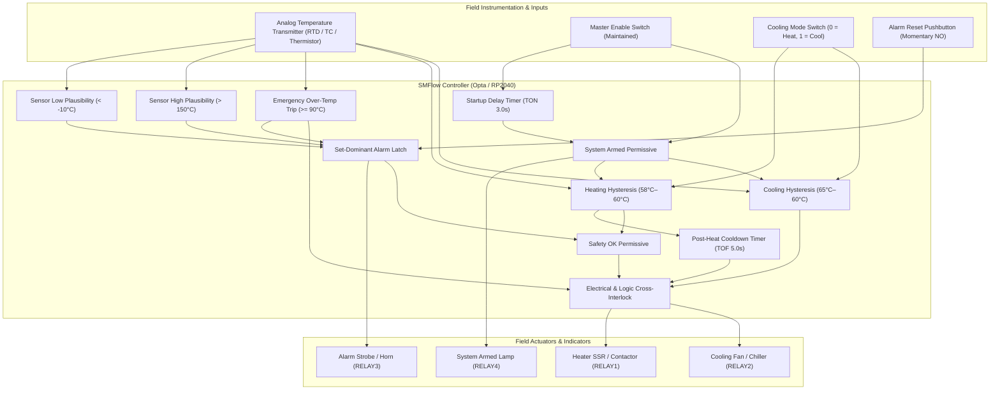

# Industrial Temperature Controller — Technical Architecture

This document specifies the technical architecture, electrical interfaces, thermodynamics, control algorithms, functional safety requirements, and fail-safe state machines for an SMFlow-based **Industrial Temperature Controller** deployed on deterministic micro-PLCs (**Arduino Opta**) and embedded targets (**Raspberry Pi Pico**).

---

## 1. Executive Summary & Thermal Dynamics

Industrial thermal management systems regulate the temperature of thermal masses (fluid tanks, process air streams, electronic enclosures, curing ovens) subject to ambient disturbances, internal heat generation, and transport delays. Operating electric resistance heaters and motorized cooling fans without properly conditioned digital control causes contactor chatter, excessive thermal stress, element burnout, and catastrophic thermal runaway.



### 1.1 Thermal Dynamics & Lumped Capacitance Formulation
A thermal zone (enclosure, liquid reservoir, or oven) can be modeled using the first law of thermodynamics and lumped capacitance:

$$m \cdot c_p \cdot \frac{dT(t)}{dt} = \dot{Q}_{in}(t) - \dot{Q}_{loss}(t)$$

Where:
- $m$ is the mass of the thermal zone (kg),
- $c_p$ is the specific heat capacity ($\text{J}/(\text{kg}\cdot\text{K})$),
- $\dot{Q}_{in}(t)$ is the electrical heating power input (W),
- $\dot{Q}_{loss}(t)$ is the total heat transfer to ambient:

$$\dot{Q}_{loss}(t) = U \cdot A \cdot \left(T(t) - T_{amb}\right)$$

Where $U$ is the overall heat transfer coefficient ($\text{W}/(\text{m}^2\cdot\text{K})$) and $A$ is surface area ($\text{m}^2$).

When heating is active ($\dot{Q}_{in} = P_{heater}$), the process temperature rises asymptotically toward a steady-state limit:

$$T(t) = T_{amb} + \frac{P_{heater}}{U \cdot A} \left(1 - e^{-t / \tau_{th}}\right)$$

Where $\tau_{th} = \frac{m \cdot c_p}{U \cdot A}$ is the thermal time constant of the system.

### 1.2 Thermal Inertia & Post-Heating Cooldown Exhaust
Electric resistance heating elements (sheathed nichrome coils embedded in magnesium oxide / ceramic substrates) operate at internal temperatures exceeding $400^\circ\text{C}$ to transfer heat into process fluids or airflow.

When electrical power to the element is interrupted upon reaching the cut-out threshold ($60.0^\circ\text{C}$), significant thermal energy remains stored in the element core ($E_{stored} = m_{elem} \cdot c_{p,elem} \cdot \Delta T_{core}$). If forced circulation stops simultaneously with heater power:
1. Airflow ceases while the element continues radiating stored heat into stagnant air.
2. Local temperatures around the heater duct spike past $120^\circ\text{C}$ ("heat soaking").
3. Extreme temperatures trip manual-reset bimetallic thermal cutoffs, melt wire insulation, and accelerate element oxidation.

The SMFlow controller solves this by triggering an automated **5.0-second post-heating cooldown sequence** via `timer_cooldown` (TOF). When heater demand drops, the cooling exhaust fan runs for 5.0s, extracting residual thermal energy before coming to rest.

### 1.3 Forced Convection Cooling & Emergency Over-Temperature Purge
When in cooling mode or emergency over-temperature purge, heat removal rate is governed by forced convective mass airflow:

$$\dot{Q}_{cooling} = \dot{m}_{air} \cdot c_{p,air} \cdot \left(T_{exhaust} - T_{inlet}\right) = \rho_{air} \cdot \dot{V}_{fan} \cdot c_{p,air} \cdot \Delta T$$

Where $\dot{V}_{fan}$ is the volumetric flow rate of the ventilation fan ($\text{m}^3/\text{s}$).

If the process temperature surges to or above the safety ceiling (`OverTempLimit` = $90.0^\circ\text{C}$), the controller locks out the heater contactor and forces the fan output on continuously, purging the cabinet or chamber with ambient air until temperatures drop to safe levels.

---

## 2. Electrical System & Interface Specification

```
[ SENSORS & TRANSMITTERS ]                            [ ARDUINO OPTA PRO CONTROLLER ]

  24VDC Loop Power (+) ─────┬────────────────────────── +24VDC Supply
                            │
  0–10V / 4–20mA Temp Tx ───┴──[ 250Ω 0.1% / Direct ]── Terminal I1 (Analog Input)
  24VDC Ground (-) ──────────────────────────────────── 0VDC / Earth Common

  Master Enable Switch ───────[ +24V Maintained ]────── Terminal I2 (Digital Input)
  Cooling Mode Switch  ───────[ +24V Maintained ]────── Terminal I3 (Digital Input)
  Alarm Reset Pushbutton ─────[ +24V NO Pushbutton ]─── Terminal I4 (Digital Input)

[ POWER CONTACTORS & ACTUATORS ]

  120VAC / 24VDC Power ─────┬────────────────────────── RELAY 1 Common
                            │
  Heater SSR / Contactor ◄──┴────────────────────────── RELAY 1 NO (10A Contact)

  120VAC / 24VDC Power ─────┬────────────────────────── RELAY 2 Common
                            │
  Cooling Fan / Chiller ◄───┴────────────────────────── RELAY 2 NO (10A Contact)

  Alarm Strobe / Horn ◄──────────────────────────────── RELAY 3 NO (10A Contact)
  System Armed Pilot Lamp ◄──────────────────────────── RELAY 4 NO (10A Contact)
```

### 2.1 Sensor Transducer Conditioning
- **RTD (Pt100 / Pt1000)**: 3-wire or 4-wire RTD connected to a DIN-rail head transmitter producing a linear $0\text{--}10\text{V}$ output calibrated across $-20^\circ\text{C}$ to $180^\circ\text{C}$.
- **Thermocouple (Type K / Type J)**: Thermocouple probe connected to an isolated cold-junction compensated transmitter. An open thermocouple fault pulls the loop high ($> 150.0^\circ\text{C}$), immediately tripping the sensor high plausibility alarm.
- **Micro-PLC Analog Input**: On Arduino Opta, terminal `I1` is configured as a high-impedance 0–10V analog input with hardware RC filtering.

### 2.2 Actuator Interlocking & SSR Snubbing
- **Heater Drive**: Driven via `RELAY1` on Opta or `GP20` on RP2040. For precision high-cycle applications, `RELAY1` pilots a Zero-Cross Solid State Relay (SSR) rated for AC resistive heating elements, eliminating electromagnetic noise (EMI).
- **Cooling Fan Drive**: Driven via `RELAY2` on Opta or `GP21` on RP2040. When driving inductive shaded-pole or PSC fan motors, an RC snubber network ($0.1\,\mu\text{F} + 100\,\Omega$) is installed across relay contacts to suppress inductive kickback.
- **Hardware & Logic Interlocking**: The graph contains an inversion gate (`not_heater`) ensuring that `CoolerOutput` cannot energize while `HeaterOutput` is commanded on, preventing simultaneous heating and cooling.

---

## 3. Calibrated Setpoints & Operational Parameters

| Variable Name | Default Value | Data Type | Engineering Unit | Function & Rationale |
| :--- | :---: | :---: | :---: | :--- |
| `HeatOnTemp` | **58.0** | `float32` | °C | Heating cut-in threshold. Heater turns ON when $T \le 58.0^\circ\text{C}$. |
| `HeatOffTemp` | **60.0** | `float32` | °C | Heating cut-out threshold. Heater turns OFF when $T \ge 60.0^\circ\text{C}$ ($2.0^\circ\text{C}$ hysteresis). |
| `CoolOnTemp` | **65.0** | `float32` | °C | Cooling cut-in threshold. Fan turns ON when $T \ge 65.0^\circ\text{C}$. |
| `CoolOffTemp` | **60.0** | `float32` | °C | Cooling cut-out threshold. Fan turns OFF when $T \le 60.0^\circ\text{C}$ ($5.0^\circ\text{C}$ hysteresis). |
| `OverTempLimit` | **90.0** | `float32` | °C | Safety trip point. Kills heater, trips latched alarm, and forces fan on. |
| `SensorMin` | **-10.0** | `float32` | °C | Plausibility floor. Readings below indicate shorted sensor wiring or wet leads. |
| `SensorMax` | **150.0** | `float32` | °C | Plausibility ceiling. Readings above indicate broken thermocouple / open wire. |
| `presetTime` (`timer_startup`) | **3000** | Milliseconds | ms | Startup on-delay (3.0s). Holds thermal outputs off during sensor power settling. |
| `presetTime` (`timer_cooldown`) | **5000** | Milliseconds | ms | Post-heating off-delay (5.0s). Runs fan to flush residual heater thermal mass. |

---

## 4. Control Logic & Node Inventory

The SMFlow controller graph consists of 50 discrete nodes arranged in a strict Directed Acyclic Graph (DAG) executing deterministically at 100 Hz (10 ms task period).

### 4.1 Node Breakdown by Functional Subsystem

| Subsystem | Node ID | Node Type | Purpose |
| :--- | :--- | :--- | :--- |
| **I/O & Setpoints** | `in_temp` | `analog-input` | Senses process temperature in °C. |
| | `in_enable` | `digital-input` | Master enable switch input. |
| | `in_cool_mode` | `digital-input` | Mode selector: 0 = Heating, 1 = Cooling. |
| | `in_reset` | `digital-input` | Operator alarm reset pushbutton. |
| | `rd_heat_on` ... `rd_sensor_max` | `variable-read` (7 nodes) | Reads calibrated setpoints and thresholds. |
| **Startup & Arming** | `timer_startup` | `ton` | 3.0s startup delay timer. |
| | `gate_control_armed` | `and` | Armed permissive: `EnableSwitch AND timer_startup.Q`. |
| **Plausibility & Alarms** | `cmp_sensor_low` | `compare` (`<`) | Detects $T < -10.0^\circ\text{C}$ (shorted sensor). |
| | `cmp_sensor_high` | `compare` (`>`) | Detects $T > 150.0^\circ\text{C}$ (open sensor). |
| | `gate_sensor_fault` | `or` | Consolidates sensor plausibility errors. |
| | `not_sensor_fault` | `not` | Inverts sensor fault for latch arming. |
| | `cmp_over_temp` | `compare` (`>=`) | Detects $T \ge 90.0^\circ\text{C}$ (emergency over-temp). |
| | `gate_any_fault` | `or` | Consolidates sensor faults and over-temp trip. |
| | `latch_alarm` | `set-reset` | Latches safety alarm ($S$ = fault, $R$ = reset). |
| | `not_alarm` | `not` | True when alarm latch is clear. |
| | `not_any_fault` | `not` | True when no physical fault currently exists. |
| | `gate_safety_ok` | `and` | Safety permissive: `not_alarm AND not_any_fault`. |
| **Heating Engine** | `cmp_heat_on` | `compare` (`<=`) | True when $T \le 58.0^\circ\text{C}$ (cut-in). |
| | `cmp_heat_off` | `compare` (`>=`) | True when $T \ge 60.0^\circ\text{C}$ (cut-out). |
| | `gate_heat_set` | `and` | Sets heating latch when cut-in met & sensor healthy. |
| | `gate_heat_reset` | `or` | Resets heating latch when target reached or fault trips. |
| | `latch_heat` | `set-reset` | Heating hysteresis memory latch. |
| | `not_cooling_mode` | `not` | Inverts mode switch (true when heating mode). |
| | `gate_heat_mode_demand` | `and` | Heating demand gated by heating mode selection. |
| | `gate_heat_run` | `and` | Heater run command: demand AND controller armed. |
| **Cooling Engine** | `cmp_cool_on` | `compare` (`>=`) | True when $T \ge 65.0^\circ\text{C}$ (cut-in). |
| | `cmp_cool_off` | `compare` (`<=`) | True when $T \le 60.0^\circ\text{C}$ (cut-out). |
| | `gate_cool_set` | `and` | Sets cooling latch when cut-in met & sensor healthy. |
| | `gate_cool_reset` | `or` | Resets cooling latch when target reached or fault trips. |
| | `latch_cool` | `set-reset` | Cooling hysteresis memory latch. |
| | `gate_cool_mode_demand` | `and` | Cooling demand gated by cooling mode selection. |
| | `gate_cool_run` | `and` | Cooler run command: demand AND controller armed. |
| **Cooldown & Outputs** | `timer_cooldown` | `tof` | 5.0s post-heat off-delay timer. |
| | `not_heating` | `not` | Inverts heater run command. |
| | `gate_cooldown_active` | `and` | Active cooldown: `timer_cooldown.Q AND not_heating`. |
| | `gate_heater_final` | `and` | Final heater drive: `gate_heat_run AND gate_safety_ok`. |
| | `gate_cool_or_cooldown` | `or` | Merges cooling mode demand and cooldown exhaust. |
| | `gate_cooler_total` | `or` | Merges cooling/cooldown with emergency over-temp purge. |
| | `not_heater` | `not` | Interlock: ensures heater is off before cooler runs. |
| | `gate_cooler_final` | `and` | Final cooler drive: `gate_cooler_total AND not_heater`. |
| | `out_heater` | `digital-output` | Drives `HeaterOutput` (RELAY1 / GP20). |
| | `out_cooler` | `digital-output` | Drives `CoolerOutput` (RELAY2 / GP21). |
| | `out_alarm` | `digital-output` | Drives `AlarmOutput` (RELAY3 / GP22). |
| | `out_active` | `digital-output` | Drives `ActiveOutput` (RELAY4 / GP27). |

---

## 5. Functional Safety & FMEA

### 5.1 Failure Modes and Effects Analysis (FMEA)

| Failure Mode | Physical Cause | Controller Detection Mechanism | System Action & Fail-Safe State |
| :--- | :--- | :--- | :--- |
| **Thermocouple Open Circuit** | Vibration breaks lead wire; screw terminal loosens. | Transmitter pulls high; `cmp_sensor_high` trips ($T > 150.0^\circ\text{C}$). | Heater drops instantly; alarm latches; fan initiates emergency purge. |
| **RTD Short Circuit** | Conduit water ingress; pinched cable to ground. | Measured voltage drops; `cmp_sensor_low` trips ($T < -10.0^\circ\text{C}$). | Heater inhibited; alarm latches; prevents thermal runaway. |
| **Heater SSR Shorted Closed** | SSR internal triac breakdown / thermal punch-through. | Temperature surges past target; `cmp_over_temp` trips ($T \ge 90.0^\circ\text{C}$). | `AlarmOutput` latches; `CoolerOutput` forces continuous exhaust purge. |
| **Rapid Power Cycling** | Supply brownout; contact bounce on master switch. | `timer_startup` (TON 3.0s) resets to zero on power drop. | Thermal outputs held off for full 3.0s window before re-energizing. |
| **Heater Element Heat Soak** | Heater turns off at $60^\circ\text{C}$ with stagnant air. | Falling edge on `gate_heat_run` triggers `timer_cooldown` (TOF 5.0s). | Exhaust fan runs for 5.0 seconds post-cutoff, removing residual core heat. |

### 5.2 Set-Dominant Alarm Latching Architecture
In safety-critical industrial applications, an operator must not be permitted to clear an alarm while the underlying hazard remains physically present.

In SMFlow `set-reset` latch blocks:
- If both $S$ and $R$ are true simultaneously, the Set input takes precedence ($Q = \text{true}$).
- In `temperature-controller.smflow`, $S = \text{gate\_any\_fault}$ and $R = \text{AlarmReset}$.
- If an over-temperature or broken sensor condition is active, pressing the `AlarmReset` button has zero effect.
- Only after the temperature physically returns to the safe operating window ($< 90.0^\circ\text{C}$ and between $-10.0^\circ\text{C}$ and $150.0^\circ\text{C}$) does pressing `AlarmReset` reset `latch_alarm`, restoring `gate_safety_ok` and permitting heater re-energization.

---

## 6. Verification & Automated Test Coverage

The accompanying test suite ([temperature-controller.smtest](file:///F:/repos/ctacke/SMFlow-Public/samples/reference/industrial-automation/temperature-controller/temperature-controller.smtest)) verifies 100% of all control paths and safety transitions across 18 deterministic test cases:

| Test Name | Asserted Condition | Expected Output State |
| :--- | :--- | :--- |
| `all outputs de-energized when enable switch is open` | `EnableSwitch == false`, $T = 25.0^\circ\text{C}$ | `Heater == false`, `Cooler == false`, `Alarm == false`, `Active == false` |
| `startup delay holds thermal outputs off during 3-second stabilization window` | `EnableSwitch == true`, $t = 2.0\text{s}$, $T = 50.0^\circ\text{C}$ | `Active == false`, `Heater == false`, `Cooler == false` |
| `startup delay completes and arms controller after 3000ms` | `EnableSwitch == true`, $t = 3.1\text{s}$, $T = 50.0^\circ\text{C}$ | `Active == true`, `Heater == true` |
| `heating mode cut-in energizes heater when temperature drops below 58C` | Heating mode, $T = 55.0^\circ\text{C}$ | `Heater == true`, `Cooler == false`, `Active == true` |
| `heating hysteresis holds heater on as temperature rises through 59C deadband` | Heating mode, $T$ rises $55^\circ\text{C} \to 59^\circ\text{C}$ | `Heater == true` (maintained) |
| `heating cut-out turns heater off when reaching 60C setpoint` | Heating mode, $T$ reaches $60.5^\circ\text{C}$ | `Heater == false` |
| `post-heat cooldown sequence operates exhaust fan for 5 seconds after heater shuts off` | Heating mode, $T$ rises to $60.5^\circ\text{C}$ (heater off) | `Heater == false`, `Cooler == true` (cooldown active) |
| `exhaust fan stops after 5-second cooldown delay expires` | Cooldown timer elapses ($+5.1\text{s}$) | `Heater == false`, `Cooler == false` |
| `cooling mode cut-in energizes cooler fan when temperature reaches 65C` | Cooling mode, $T = 66.0^\circ\text{C}$ | `Cooler == true`, `Heater == false`, `Active == true` |
| `cooling hysteresis holds cooler on as temperature drops through 62C deadband` | Cooling mode, $T$ drops $66^\circ\text{C} \to 62^\circ\text{C}$ | `Cooler == true` (maintained) |
| `cooling cut-out stops cooler fan when temperature reaches 60C setpoint` | Cooling mode, $T$ drops to $59.5^\circ\text{C}$ | `Cooler == false`, `Heater == false` |
| `emergency over-temperature trips alarm, shuts heater off, and forces cooler fan on` | $T = 92.0^\circ\text{C}$ | `Alarm == true`, `Heater == false`, `Cooler == true` |
| `alarm remains latched after temperature drops back below over-temperature threshold` | $T$ drops $92^\circ\text{C} \to 50^\circ\text{C}$, no reset | `Alarm == true`, `Heater == false` (latched) |
| `alarm cannot be cleared while over-temperature condition persists (set-dominant)` | $T = 92.0^\circ\text{C}$, `AlarmReset == true` | `Alarm == true` (reset rejected) |
| `alarm clears and heater resumes when reset button pressed after temperature normalizes` | $T = 55.0^\circ\text{C}$, `AlarmReset` pulsed | `Alarm == false`, `Heater == true` |
| `sensor low plausibility fault trips alarm and prevents heater activation` | $T = -15.0^\circ\text{C}$ (< -10°C) | `Alarm == true`, `Heater == false`, `Cooler == false` |
| `sensor high plausibility fault trips alarm and shuts off heater` | $T = 160.0^\circ\text{C}$ (> 150°C) | `Alarm == true`, `Heater == false` |
| `opening enable switch de-energizes thermal outputs and clears armed indicator` | `EnableSwitch` opened | `Active == false`, `Heater == false` |

---

## 7. Build & Compilation Verification

```powershell
# Build C++ firmware for Arduino Opta
smflow build samples/reference/industrial-automation/temperature-controller/temperature-controller.smflow --target opta

# Build C++ firmware for Raspberry Pi Pico
smflow build samples/reference/industrial-automation/temperature-controller/temperature-controller.smflow --target rp2040-pico
```
